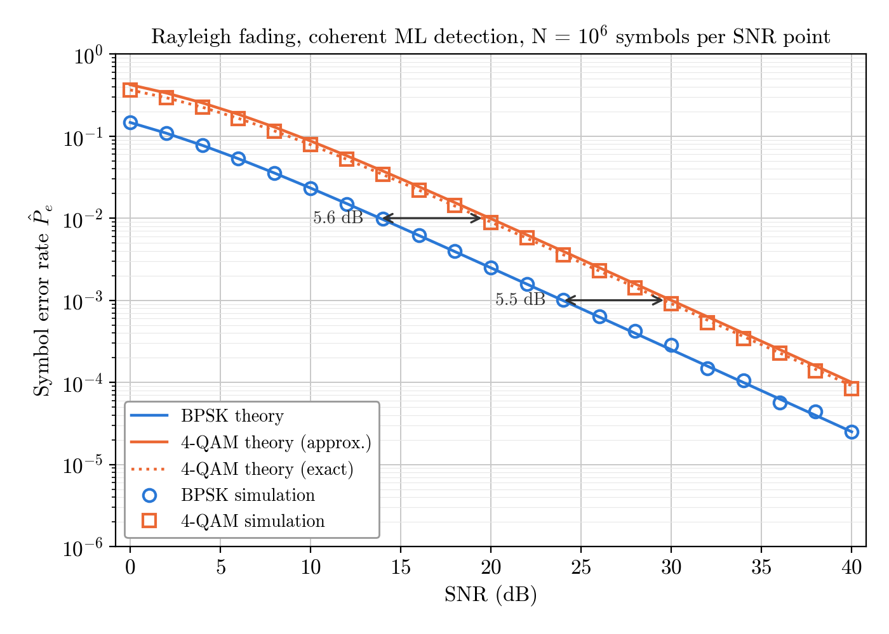
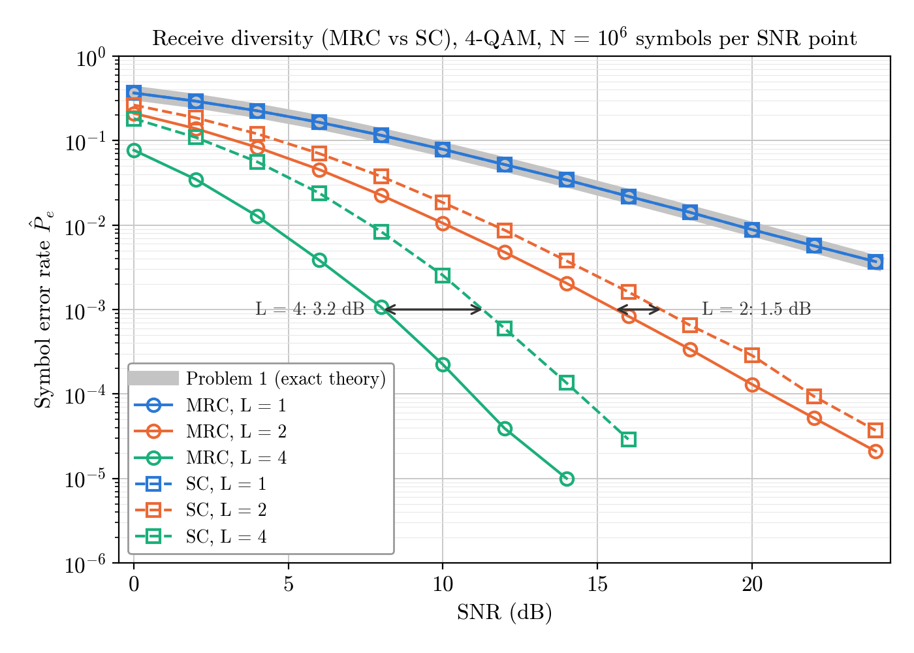
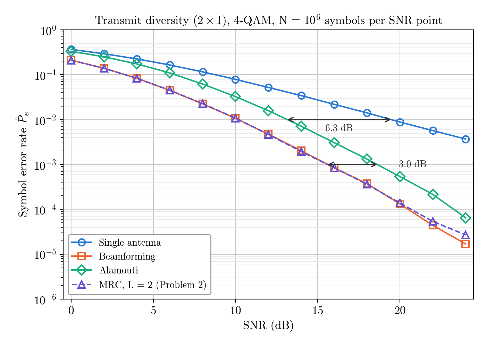

# Detection and Diversity in AWGN and Fading Channels

**EC5.407 Wireless Communications — Assignment 2**<br>
Ande Karthik · 2023102009

Monte Carlo simulation of symbol detection, receive diversity and transmit
diversity, written from scratch in Python. Every simulated SER curve is checked
against theory.

- **Report:** [report/report.pdf](report/report.pdf) (20 pages)
- **Assignment statement:** [WC_Assignment_2.pdf](WC_Assignment_2.pdf)

| Problem | Topic | Simulated |
|:---:|---|---|
| 1 | Detection in AWGN and fading | BPSK and 4-QAM in AWGN (0–12 dB) and Rayleigh fading (0–40 dB) |
| 2 | Receive diversity | 4-QAM, 1 × L channel, MRC and selection combining (SC), L = 1, 2, 4 (0–24 dB) |
| 3 | Transmit diversity | 4-QAM, 2 × 1 channel: single antenna, beamforming, Alamouti, vs MRC L = 2 (0–24 dB) |

## Results at a glance

<p align="center">
  
  
  
</p>

## Quick start

Requires **Python 3.12** (tested with 3.12.3). Run every command from the project
root; the scripts run as modules so that they can import the shared `common`
package.

```bash
pip install numpy scipy matplotlib

python3 -m problem1.awgn_ser
python3 -m problem1.rayleigh_ser
python3 -m problem2.receive_diversity
python3 -m problem3.transmit_diversity
python3 -m overall_check                  # run last: reads the CSV files of the others

cd report && pdflatex report.tex && pdflatex report.tex
```

**Random seed: 2026**, set once at the start of each script with
`np.random.default_rng(2026)`. Re-running the scripts reproduces every figure,
table and number byte for byte.

## Requirements

| | Version | Used for |
|---|---|---|
| Python | 3.12.3 | everything |
| numpy | 2.3.4 | simulation and theory |
| scipy | 1.16.3 | only `scipy.special.erfc`, for the Q-function (allowed by the assignment) |
| matplotlib | 3.10.7 | figures (Computer Modern font ships with it; no extra fonts needed) |
| TeX Live | 2023 | report only: `pdflatex` with `pgfplots`/`pgfplotstable`, `booktabs`, `caption`, `placeins`, `enumitem`, `hyperref` |

## Reproducing each problem

| Command | Reproduces | Report figures | Output folder | Time |
|---|---|:---:|---|---:|
| `python3 -m problem1.awgn_ser` | Problem 1, Task 1 (AWGN) | 1 | `results/q1/` | ~6 s |
| `python3 -m problem1.rayleigh_ser` | Problem 1, Task 2 (Rayleigh fading) | 2, 3 | `results/q1/` | ~13 s |
| `python3 -m problem2.receive_diversity` | Problem 2 (MRC and SC) | 4, 5 | `results/q2/` | ~31 s |
| `python3 -m problem3.transmit_diversity` | Problem 3 (transmit diversity) | 6, 7 | `results/q3/` | ~23 s |
| `python3 -m overall_check` | all points vs exact theory | Tables 1, 2 | `results/` | ~1 s |

Each script prints its SER table and summary, and writes its figures, data and
summary to `results/`. The report reads its figures and appendix tables directly
from there, so every figure and number in it comes from these scripts.

## Repository layout

```
.
├── README.md
├── WC_Assignment_2.pdf          assignment statement
├── overall_check.py             every plotted point vs exact theory
├── common/                      building blocks shared by all problems
│   ├── constellation.py         unit-energy BPSK and 4-QAM
│   ├── channel.py               AWGN, Rayleigh, 1 x L and 2 x 1 channels
│   ├── detector.py              ML (minimum-distance) detector
│   ├── combining.py             receive combiners: none, MRC, SC
│   ├── theory.py                Q-function and all theoretical SER expressions
│   ├── simulation.py            Monte Carlo loop (Algorithm 1), error counting
│   ├── plotting.py              figures and CSV tables
│   └── analysis.py              SNR gaps, slopes, deviations from theory
├── problem1/
│   ├── awgn_ser.py              Task 1: AWGN
│   └── rayleigh_ser.py          Task 2: Rayleigh fading
├── problem2/
│   └── receive_diversity.py     MRC and SC, L = 1, 2, 4
├── problem3/
│   └── transmit_diversity.py    single antenna, beamforming, Alamouti, MRC L = 2
├── results/
│   ├── q1/  q2/  q3/            figures (.pdf), SER tables (.csv), summaries (.txt)
│   │   └── images/              PNG copy of every figure
│   └── overall_check.txt
└── report/
    ├── report.tex
    └── report.pdf
```

## Outputs

| Problem | Figures | Tables and summaries |
|:---:|---|---|
| 1 | `awgn_ser`, `rayleigh_ser`, `awgn_vs_rayleigh` (extra) | `awgn_ser.csv`, `rayleigh_ser.csv`, `awgn_summary.txt`, `rayleigh_summary.txt` |
| 2 | `receive_diversity`, `receive_diversity_theory` (extra) | `receive_diversity.csv`, `receive_diversity_theory.csv`, `summary.txt` |
| 3 | `transmit_diversity`, `transmit_diversity_theory` (extra) | `transmit_diversity.csv`, `transmit_diversity_theory.csv`, `summary.txt` |

- **Figures** are saved as vector `.pdf` (used in the report) and as `.png` in
  `images/` (for quick viewing). Every figure has labelled axes and a legend, and
  shows only points with at least 10 errors.
- **CSV tables** have one row per SNR point: for each simulated curve the SER
  (`sim`) and error count (`n_err`), and one column per theory curve.
- **Summaries** hold every number quoted in the report: agreement with theory,
  slopes, SNR gaps, array gains, the energy check and the deep-fade statistics.

## How the code works

Every simulation follows the same chain:

```
constellation -> (transmitter) -> channel -> receiver / combiner -> ML detector -> error count
```

Each receiver turns what it receives into one **equivalent scalar channel**
`r = g x + n` with `n ~ CN(0, 1/SNR)`, so the same ML detector,
`argmin_m |r - g u_m|^2`, is reused unchanged in all three problems:

| Receiver | Output r | Gain g |
|---|---|---|
| Single antenna (Problem 1) | y | h |
| MRC (Problem 2) | hᴴy / ‖h‖ | ‖h‖ |
| SC (Problem 2) | y of the strongest antenna | h of that antenna |
| Beamforming (Problem 3) | y | ‖h‖ |
| Alamouti (Problem 3) | (h₁* y₁ + h₂ y₂*) / ‖h‖, and similarly for x₂ | ‖h‖ / √2 |

All schemes transmit a total energy of 1 per channel use, so the comparison is fair.

## Assignment requirements

| Requirement | How it is met |
|---|---|
| No built-in modulation, detection or error-rate functions | all written by hand in `common/` |
| Separate functions for each block | `bpsk`/`qam4`, the `*_channel` functions, `ml_detect`, `count_symbol_errors`, `qfunc` and the `ser_*` functions |
| Same constellation and detector reused | every problem imports them from `common/` |
| Vectorised simulation | all N symbols of an SNR point at once; loops only over SNR points, schemes and L |
| Reproducible | seed 2026 set once per script; outputs identical on every run |
| N = 10⁶ symbols per SNR point | `N_SYMBOLS = 10**6` (Alamouti: N/2 blocks of two symbols) |
| Plot only points with at least 10 errors | `MIN_ERRORS = 10` in `common/plotting.py` |

## Main results

- **All problems:** every simulated curve agrees with its exact theory. Over 160
  independent points, 71% lie within 1σ and 95% within 2σ (68% and 95% expected).
- **Problem 1:** fading turns the exponential AWGN "waterfall" into a 1/SNR law,
  because errors come from deep fades (about 75% of all errors happen in one).
  BPSK needs 17.3 dB more SNR in fading at SER 10⁻³, and 25.8 dB more at 10⁻⁴.
  The 4-QAM fading formula of the assignment table is about 10% too high, because
  it ignores the case where I and Q are both wrong.
- **Problem 2:** MRC and SC both reach diversity order L. MRC has the larger array
  gain (3.01 / 6.02 dB against 1.76 / 3.19 dB), so SC needs about 1.5 dB (L = 2)
  and 3.2–3.5 dB (L = 4) more SNR.
- **Problem 3:** beamforming, Alamouti and MRC L = 2 all reach diversity order 2.
  Beamforming equals MRC L = 2; Alamouti is 3.0 dB behind because, without channel
  knowledge at the transmitter, it has no array gain.

## Report structure

| Section | Contents |
|:---:|---|
| 1 | Simulation set-up: conventions, code, accuracy, exact theory, overall check |
| 2 | Problem 1: Task 1 (AWGN), Task 2 (Rayleigh fading), discussion |
| 3 | Problem 2: Task 1 (MRC and SC), Task 2 (simulation), discussion |
| 4 | Problem 3: Task 1 (beamforming, Alamouti, energy check), Task 2 (simulation), discussion |
| 5 | Summary of the SNR gaps marked in the figures |
| A | Appendix: all simulated SER values next to theory |

Every figure caption states the SNR range and the number of Monte Carlo symbols
per SNR point (N = 10⁶).
